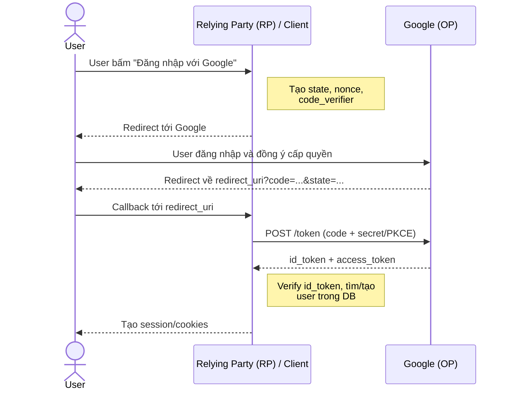

# OIDC

## Vai trò

- End user: người dùng
- Relying Party (RP) / Client: ứng dụng của bạn
- OpenID Provider (OP): e.g. Google

## Luồng phổ biến

### 1. Chuyển hướng user sang Google

App sẽ redirect user tới:

```text
https://accounts.google.com/o/oauth2/v2/auth
  ?client_id=YOUR_CLIENT_ID
  &redirect_uri=https://yourapp.com/auth/callback
  &response_type=code
  &scope=openid email profile
  &state=RANDOM_STRING
  &nonce=RANDOM_STRING
  &code_challenge=...&code_challenge_method=S256
```

Một số tham số quan trọng:

- `scope=openid`: tham số bắt buộc báo cho Google là đang dùng OIDC, `email` `profile`là xin thêm thông tin
- `state`: chuỗi ngẫu nhiên lưu ở server/session, chống CSRF, Google trả về phải matching
- `nonce`: chuỗi ngẫu nhiên, sẽ xuất hiện trong ID token, chống replay attack
- PKCE (`code_challenge`): chống đánh cắp authorization code, bắt buộc với SPA/Mobile nên dùng cả với web server

### 2. User xác thực tại Google

### 3. Google redirect về app kèm `code`

`https://yourapp.com/auth/callback?code=4/0AX4...&state=RANDOM_STRING`

App kiểm tra `state` khớp với giá trị đã lưu, reject nếu không khớp

### 4. Đồi `code` lấy token (server-to-server)

```text
POST https://oauth2.googleapis.com/token
Content-Type: application/x-www-form-urlencoded

grant_type=authorization_code
&code=4/0AX4...
&client_id=YOUR_CLIENT_ID
&client_secret=YOUR_CLIENT_SECRET
&redirect_uri=https://yourapp.com/auth/callback
&code_verifier=...

Response:
{
  "access_token": "ya29....",
  "id_token": "eyJhbGciOiJSUzI1NiIs...",
  "expires_in": 3599,
  "refresh_token": "...",   // chỉ có nếu xin access_type=offline
  "token_type": "Bearer"
}
```

### 5. Xác minh ID token

ID token là 1 JWT gồm 3 phần `header.payload.signature`, giải ma ra có dạng:

```json
{
  "iss": "https://accounts.google.com",
  "aud": "YOUR_CLIENT_ID",
  "sub": "110169484474386276334",
  "email": "user@gmail.com",
  "email_verified": true,
  "name": "Nguyen Van A",
  "picture": "https://...",
  "iat": 1730000000,
  "exp": 1730003600,
  "nonce": "RANDOM_STRING"
}
```

Bắt buộc verify:

- Chữ ký: dùng public key của Google (`jwks_uri`, xem Discovery Document)
- `iss`: đúng Google
- `aud`: đúng `client_id` của bạn (tránh nhận token app khác)
- `exp`: chưa hết hạn
- `nonce`: khớp giá trị đã gửi

*Khuyến nghị dùng thư viện có sắn: oogle-auth-library, openid-client, Authlib, passport, Spring Security*

### 6. Login hoặc Signup trong hệ thống của bạn

- `sub`+`iss`: định danh duy nhất của user bên Google, dùng `sub` làm khóa định
  danh vì luôn cố định, còn `email` có thể thay đổi

### 7. Bổ sung: Discovery Document

OIDC có endpoint để lấy toàn bộ cấu hình:
`https://accounts.google.com/.well-known/openid-configuration`, trả về
`authorization_endpoint`, `token_endpoint`, `jwks_uri`, `userinfo_endpoint`,
nhiều thư viện chỉ cần URL cấu hình này là xong

Các loại token:

- ID Token
- Access Token
- Refresh Token

Setup GCP:

- Vào Google Cloud Console -> APÍ & Services -> Credentials
- Tạo OAuth 2.0 Client ID (Web Application)
- Khai báo Authorized redirect URIs (vd: https://yourapp.com/auth/callback)
- Lấy `client_id` và `client_secret`
- Cấu hình OAuth consent screen

### 8. Diagram


